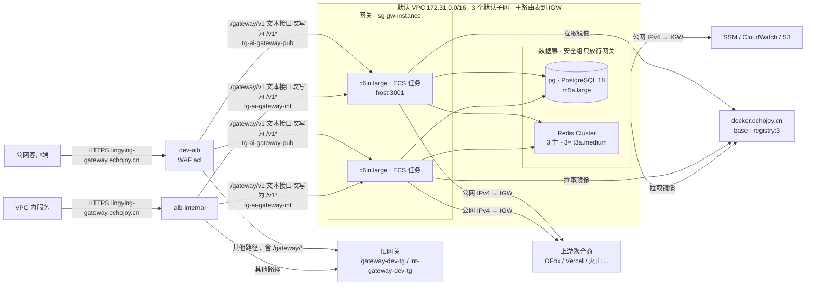

# 生产部署计划：AWS 宁夏（ECS 网关 + EC2 自建 PostgreSQL 与 Redis Cluster）

- 区域：`cn-northwest-1`（宁夏，西云数据运营），账号 `015060879373`
- 调研日期：2026-10-13，基于提交 `394b2af3`。2026-10-14 按需求改为 amd64 机型和自建镜像仓库 `docker.echojoy.cn`
- 状态：计划草案，尚未创建任何资源

本文回答两个问题：生产环境怎么搭，以及为什么这样搭。网关对带宽要求高，所以带宽设计单独成章（第 4 节）。

## 1. 结论

1. 网关跑在 **ECS on EC2** 上，所有服务器都用 **amd64**。网关使用小规格的 `c6in.large`（Intel Ice Lake，2 vCPU、4 GiB，**基线带宽 3.125 Gbps**，宁夏唯一的 x86 网络优化机型），`host` 网络模式，每台实例一个任务。单机性能不高，靠横向扩容，起步 2 台，分布在 2 个 AZ。数据层没有冗余，网关分散到 3 个 AZ 也换不来 AZ 级容灾，所以 2 台只用来保证实例级冗余和滚动发布。
2. **数据面流量不经过 NAT 网关。** 网关实例放在默认公有子网，用自己的公网 IPv4 通过 IGW 直连上游聚合商。NAT 网关对两个方向的流量都按 ¥0.37/GB 收处理费，对同一目标还有 55,000 并发连接的上限。
3. **入口复用现有的 `dev-alb`（公网）和 `alb-internal`（VPC 内），不新建 ALB。** 沿用域名 `lingying-gateway.echojoy.cn`，按路径分流：旧网关的文本大模型接口 `/gateway/v1/chat/completions`、`/gateway/v1/messages*`、`/gateway/v1/responses*` 去掉 `/gateway` 前缀后转给新集群，调用方的 `base_url` 和 key 都不用改；图片、视频、任务、模型列表、账户等其他 `/gateway/*` 接口照旧转给旧网关（2026-10-15 调整）。新网关的 Web UI 和管理接口不对外暴露，也不新增域名，运维通过 SSM 端口转发访问（5.3 节）。
4. **Redis Cluster** 由 3 台 `t3a.medium`（AMD，2 vCPU、4 GiB）组成，每个 AZ 一个主节点，本期不配副本。
5. **PostgreSQL 18** 单台 `m5a.large`（AMD，2 vCPU、8 GiB），不配从库，网关通过固定私有 IP `172.31.15.21` 访问，与 Redis 的做法一致。数据靠每 4 小时一次的 EBS 快照和每小时一次的逻辑备份保护。
6. 数据层没有冗余，实例级故障依靠 EC2 自动恢复（保留实例 ID、私有 IP 和 EBS）。需要更高可用性时，可以在线给 Redis 加副本、给 PostgreSQL 加从库，见第 14 节。
7. **不使用 NAT 网关。** 数据层也放在默认公有子网，每台带公网 IP，用来拉镜像、远程登录和上报监控。安全组不放行任何来自公网的入站，只允许网关访问 5432 和 6379 端口。
8. 复用默认 VPC `vpc-0ca92ebcce25cb3e4` 和它的 3 个默认子网，不新建子网和路由表，只新建安全组。两层之间靠安全组隔离。
9. **镜像放在现有的自建仓库 `docker.echojoy.cn`**（账号 `admin`），不建 ECR。仓库是单点，不可用时网关无法扩容和发布，见 9.1 节和第 14 节。
10. 成本大头是**公网出流量 ¥0.933/GB**：平均每 1 Gbps 出流量约 ¥30.6 万/月，固定资源约 ¥2,620/月（按需价，不含税，不购买预留实例）。降本要从减少出流量的字节数入手，换机型省不了多少（见 4.7）。

## 2. 输入与约束

### 2.1 已确认的需求

| 项目 | 结论 | 来源 |
|---|---|---|
| 调用方 | 主要是公网客户端，响应全部计入公网出流量 | 用户确认 |
| 峰值带宽 | 暂无数据。按 1 到 2 Gbps 起步设计，要求能横向扩展 | 用户确认 |
| 上游 | 国内可直连的聚合商（OFox、Vercel AI Gateway、火山引擎等），不需要境外中转 | 用户确认 |
| VPC | 复用默认 VPC | 用户确认 |
| 数据库与缓存 | PostgreSQL 和 Redis Cluster 自建在 EC2 上，不用 RDS 或 ElastiCache | 用户要求 |
| 数据层冗余 | Redis 3 台、不配主从。PostgreSQL 不配从库 | 用户要求 |
| 数据迁移 | 服务尚未上线，没有生产数据，无需迁移 | 项目约定 |
| CPU 架构 | 所有服务器用 amd64 | 用户要求（2026-10-14） |
| 镜像仓库 | 使用现有的 `docker.echojoy.cn`，账号 `admin` | 用户要求（2026-10-14） |

### 2.2 账号现状

以下内容通过 `aws` CLI 只读探查得到。

| 项目 | 现状 | 对本方案的影响 |
|---|---|---|
| AZ | `cn-northwest-1a/b/c`（`cnnw1-az1/2/3`） | 三个 AZ 都能用 |
| VPC | 只有默认 VPC `172.31.0.0/16`，已有 IGW `igw-0a50b509cab7de20a`，没有 NAT 网关和 VPC Endpoint | 不需要新建子网和路由表 |
| 已用网段 | `172.31.0.0/20`、`16.0/20`、`32.0/20`（默认公有子网）。`172.31.48.0/25` 至 `172.31.50.128/25`（RDS 和 media-sync 的私有子网） | 3 个默认子网各剩约 4080 个 IP，直接复用 |
| 现有网关 | `lingying-gateway.echojoy.cn`，跑在 3 台 `c5.xlarge` 上。`dev-alb` 的 443 监听器优先级 2 按域名把所有路径转给 `gateway-dev-tg`。`alb-internal` 优先级 1 把 `/admin/*` 转给 `int-gateway-admin-tg`，优先级 2 把其余路径转给 `int-gateway-dev-tg`。旧网关不使用 `/api/v1/*` 和 `/api/v1beta/*` | 新集群与旧网关共用这两个 ALB，按路径分流（5.3 节） |
| WAF | `dev-alb` 挂着 Web ACL `acl`。优先级 2 的 `block-llm-api-endpoints` 拦截所有以 `/v1/chat/completions` 或 `/v1/messages` 结尾的路径，是人工加的，可以移除。`alb-internal` 没有挂 WAF | 上线时移除这条规则（5.3 节） |
| 现网流量 | 网关实例 14 天 5 分钟粒度峰值 16.8 Mbps，`dev-alb` 峰值 56 Mbps | 只是开发期量级，不能作为生产基线 |
| 媒体卸载 | `lambda-offload-internal-alb` 后面挂着 `vercel-gpt-image`、`ofox-gpt-image` 等 Lambda，日均约 800 次，单次约 40 秒，结果写入 AssetHub | 说明团队已有用 URL 代替 base64 返回媒体的做法（见 4.7） |
| 证书 | ACM `*.echojoy.cn`，`AMAZON_ISSUED`，2027-04-13 到期，可自动续期 | ALB 直接使用 |
| DNS | Route 53 公有托管区 `echojoy.cn` 是权威 DNS。`dev-alb` 已在公网 443 提供服务 | 沿用 `lingying-gateway.echojoy.cn`，不新增域名，备案不受影响 |
| 配额 | 按需标准实例 1152 vCPU，EIP 5 个（已用 1），VPC 5 个 | 本方案不使用 EIP，公网 IP 全部自动分配，不占配额 |
| 镜像 | 自建仓库 `docker.echojoy.cn` 跑在 `base`（`t2.medium`，AZ 1b）上，经 `dev-alb` 和 `alb-internal` 的优先级 99 规则对外提供服务。没有 ECR 仓库 | 镜像在本地构建后推送到 `docker.echojoy.cn`（9.1 节） |
| 可用的 x86 机型 | `c6in`、`c8i`、`c8i-flex`、`c6i`、`c5`、`c5a`、`m8i`、`m6i`、`m5`、`m5a`、`r8i`、`t3`、`t3a` 等，3 个 AZ 都有（`c5a` 只有 1a 和 1c）。没有 `c5n`、`c7i`、`c7a`，网络优化型只有 `c6in` | 见 4.3 |

### 2.3 影响部署的网关行为

| 行为 | 代码位置 | 部署上的后果 |
|---|---|---|
| 只有一个 HTTP 端口（`PORT`，默认 3001），不处理 TLS | `internal/app/app.go:221-228` | 负载均衡必须终止 TLS |
| 收到 SIGTERM 后立即取消所有在途请求，包括流式请求 | `internal/httplifecycle/coordinator.go:124-150` | 排空只能靠 ALB 的 deregistration delay，必须在 SIGTERM 之前完成 |
| `/health` 并行 ping 数据库和 Redis，任一失败返回 503 | `internal/app/readiness.go:14-44` | 依赖抖动会让所有任务同时不健康，健康检查阈值要放宽 |
| 不信任任何转发头，来源 IP 取 TCP 对端地址 | `internal/app/app.go:122` | 在 ALB 后面，AccessKey 的 `allowed_cidrs` 和管理端登录失败锁定看到的都是 ALB 节点 IP |
| 分组默认 `request_timeout` 600 秒，`first_byte_timeout` 120 秒 | `internal/state/runtime_settings.go:82-85` | ALB 空闲超时和排空时长都按 600 秒对齐 |
| 请求体整体读入内存，上限 128 MiB，并受 `READ_TIMEOUT` 限制 | `internal/gateway/handler.go:42,890-925` | 大上传占内存，`READ_TIMEOUT` 要放宽 |
| 上游请求一律带 `Accept-Encoding: identity`，网关自己也不压缩响应 | `internal/gateway/execution_forward.go:761` | 所有字节都按原始大小计费 |
| 多个 `REDIS_ADDRS` 时使用 `ClusterClient`，不支持 ACL 用户名 | `internal/cluster/client.go:40-54` | `REDIS_ADDRS` 列出所有节点，用 `requirepass` 鉴权 |
| 每个副本启动时自动迁移，迁移由 advisory lock 串行化，最多等 1 分钟 | `internal/storage/migration_lock.go:11-40` | 多副本可以同时启动，健康检查宽限期至少 120 秒 |
| 每个副本的数据库连接池上限为 `DATABASE_MAX_OPEN_CONNECTIONS`（默认 10） | `internal/platform/config/config.go:116-134` | `max_connections` 要覆盖滚动部署时副本数翻倍的情况 |
| 请求日志异步批量写入，队列 4096，满了就丢弃 | `internal/requestlog/service.go:20-26` | PostgreSQL 写入压力与请求数成正比，和字节数无关 |
| 没有 `/metrics` 端点，日志输出到 stdout | `internal/platform/utils/logger_utils.go` | 监控依靠 ALB、EC2、Container Insights 的指标和 CloudWatch Logs |
| OAuth 回调端口 1455、54545、51121 不是必需的，授权时可以把回调 URL 粘贴回控制台 | `internal/control/oauth_callback.go`，`README_CN.md:255` | 只对外开放 3001 |
| 发布流程构建 `linux/amd64` 和 `linux/arm64` 两个架构。Dockerfile 的 Go 编译阶段在 `$BUILDPLATFORM` 上按 `TARGETARCH` 交叉编译 | `.github/workflows/release.yml:288-295,440-447`，`Dockerfile:15-36` | 可以用 amd64。在 arm64 的 Mac 上构建 amd64 镜像时，Go 代码不在模拟器里编译 |

## 3. 总体架构



| 层 | 组件 | 规格 | 位置 |
|---|---|---|---|
| 入口 | 复用 `dev-alb` 和 `alb-internal`，新增目标组 `tg-ai-gateway-pub` 和 `tg-ai-gateway-int` | 按 LCU 自动扩缩 | ALB 留在默认子网，不变 |
| 网关 | ECS 集群 `echojoy-gateway-prod`，容量提供程序为 ASG | `c6in.large` × 2 起，最多 24 个任务 | ASG 覆盖 3 个默认子网，起步的 2 台落在不同 AZ |
| 缓存 | Redis 7.4 Cluster，3 主无副本 | `t3a.medium` × 3 | 3 个默认子网，每个 AZ 一台 |
| 数据库 | PostgreSQL 18 单实例 | `m5a.large` × 1，gp3 200 GB | 默认子网 1a |
| 出网 | 所有实例都用自动分配的公网 IP 经 IGW 出网 | 不使用 NAT | |
| 镜像 | 现有自建仓库 `docker.echojoy.cn` | `registry:3`，单实例 | `base`，AZ 1b |

## 4. 带宽设计

### 4.1 流量路径与计费

网关是代理，每个字节在实例上进出各一次。下表按方向列出流量和单价（宁夏价格，2026-10 查询）：

| 路径 | 内容 | 单价 |
|---|---|---|
| 客户端 → ALB → 网关 | 请求体（图片编辑上传最大 128 MiB） | 公网入站免费，ALB 按处理字节计 LCU |
| 网关 → 上游 | 转发的请求体，其中压缩过的请求体已被解压 | **出公网 ¥0.933/GB** |
| 上游 → 网关 | 响应，包括 SSE 流和 base64 图片 | 入站免费（不经过 NAT 时） |
| 网关 → ALB → 客户端 | 响应 | **出公网 ¥0.933/GB**，另计 LCU |
| ALB → 网关（跨 AZ） | ALB 内部转发 | ALB 跨 AZ 不收费 |
| 网关 ↔ Redis 和 PostgreSQL（跨 AZ） | 计数器、日志等元数据 | ¥0.067/GB，量很小 |

AWS（包括西云数据运营的宁夏区域）的公网流量**只按 GB 计费**，不能像国内云厂商那样按固定带宽（Mbps）购买。Pricing API 里宁夏的公网出流量只有一个计价项：`AWS Outbound | External | ¥0.933/GB`。机型规格里的 "12.5 Gbps" 只是网卡能达到的速率上限，不是买断的公网带宽，价格里也不包含任何流量。入站流量免费。CloudFront 的边缘出流量更便宜：账号最近 14 天 CloudFront 分发 678 GB、费用 ¥209，约 ¥0.31/GB（Cost Explorer，2026-09-29 至 10-12）。但价格表里宁夏回源到 CloudFront 也按 ¥0.933/GB 计费。网关的响应每次都不同，不能缓存，每个字节都要回源，所以加 CloudFront 对网关省不了钱，还要多付边缘流量费。可缓存的媒体文件则不同，见 4.7。

所以出流量大致等于**客户端收到的字节加上转发给上游的字节**。ALB 的 LCU 按处理字节计，约 1 GB 对应 1 LCU 小时（¥0.072），相当于 ¥72/TB，比出流量费低一个数量级。

### 4.2 数据面不经过 NAT

网关任务需要访问公网上游。可选的出网方式如下：

| 方式 | 每 GB 额外费用 | 连接限制 | 结论 |
|---|---|---|---|
| 私有子网 + NAT 网关 | ¥0.37/GB，**两个方向都收**，上游返回的大响应也要收 | 同一目标 IP:端口最多 55,000 个并发连接 | 不用于数据面 |
| 公有子网 + 实例公网 IPv4 → IGW | 无 | 只受实例自身的带宽和连接跟踪配额限制 | **采用** |
| `awsvpc` 模式的 EC2 任务 | 任务 ENI 拿不到公网 IP，只能走 NAT | 同 NAT | 不采用 |

以 1 Gbps 的上游响应流量为例：经过 NAT 每月要多付约 328 TB × ¥0.37 ≈ ¥12 万。同时，聚合商通常只有少数几个入口 IP，几千个并发流式连接会逼近 55,000 的上限。

公网 IP 的代价是：实例替换后出口 IP 会变。如果某个聚合商要求 IP 白名单，就给这个渠道单独配出站代理（`internal/outboundproxy` 支持按凭据或分组设置代理），而不是把整个数据面挪到 NAT 后面。

### 4.3 实例选型

所有服务器都用 amd64（x86_64）。AWS 的 "up to X Gbps" 指突发上限。4xlarge 及以下的规格只能在短时间内突发，**持续吞吐以基线带宽为准**。下表是宁夏可用的 x86 候选机型（2026-10-14 用 `describe-instance-types` 和 Pricing API 查询）：

| 机型 | vCPU / 内存 | 基线 / 突发（Gbps） | ¥/小时 | ¥/月 | ¥ 每 Gbps 基线小时 |
|---|---|---|---|---|---|
| `t3.medium` | 2 / 4 GiB，CPU 可突发 | 0.256 / 5 | 0.192 | 140 | 0.75 |
| `c6i.large` | 2 / 4 GiB | 0.781 / 12.5 | 0.493 | 360 | 0.63 |
| `c8i-flex.large` | 2 / 4 GiB | 0.468 / 12.5 | 0.516 | 377 | 1.10 |
| `c8i.large` | 2 / 4 GiB | 0.937 / 12.5 | 0.543 | 397 | 0.58 |
| **`c6in.large`** | 2 / 4 GiB | **3.125 / 25** | 0.887 | **648** | **0.28** |
| `c6in.xlarge` | 4 / 8 GiB | 6.25 / 30 | 1.774 | 1,295 | 0.28 |
| `c5.xlarge`（现网） | 4 / 8 GiB | 1.25 / 10 | 0.986 | 720 | 0.79 |

服务的设计是单机性能不高、靠横向扩容，所以选小规格。选 `c6in.large` 的理由：

- 它是宁夏唯一的 x86 网络优化机型，单位带宽成本只有其他机型的一半以下。
- 2 个 vCPU 配 3.125 Gbps 基线带宽，带宽相对 CPU 足够宽，CPU 会先饱和，所以**扩缩只需看 CPU 一个信号**。`c8i.large` 每台便宜 ¥251/月，但基线带宽只有 0.937 Gbps，可能先于 CPU 被打满，此时 CPU 扩缩策略不会触发。`t3` 的基线带宽只有 0.256 Gbps，不适合承载网关。
- x86 的 C 系列最小就是 large，没有 1 vCPU、2 GiB 的规格。4 GiB 内存能容纳网关读入内存的 128 MiB 请求体和 64 MiB 非流式图片响应。

代价有三个，都在 P4 验证：

- 每台比 ARM 方案的 `c6gn.large`（¥363/月）贵 ¥285/月。宁夏的 x86 机型里没有更便宜的网络优化型。
- x86 的 vCPU 是超线程，2 个 vCPU 只对应 1 个物理核，单台能承担的 CPU 负载可能比同为 2 vCPU 的 Graviton 低，需要的台数要按压测结果确定。
- 如果 P4 测出单任务 CPU 到 60% 时出流量还不到 0.56 Gbps（`c8i.large` 基线的 60%），说明 CPU 远早于带宽饱和，`c6in` 的带宽用不上，改用 `c8i.large`，每台每月省 ¥251。如果出现内存压力或 OOM，改用 `c6in.xlarge`（4 vCPU、8 GiB、基线 6.25 Gbps）。

### 4.4 为什么用 ECS on EC2 加 host 网络模式

| 方案 | 带宽 | 出网 | 结论 |
|---|---|---|---|
| Fargate（x86，2 vCPU / 4 GB，¥0.61/小时，约 ¥445/月） | **官方没有公布带宽数字** | 公有子网加 `assignPublicIp` 可以直连 IGW | 比 `c6in.large` 每台便宜 ¥203/月，但带宽没有保证，不采用 |
| EC2 加 `awsvpc` | 由实例决定 | 只能走 NAT | 不采用（见 4.2） |
| EC2 加 `bridge` 动态端口 | 由实例决定 | 每个包都要经过 docker 的 iptables NAT 和 conntrack | 大连接数时额外消耗 CPU 和连接跟踪表 |
| **EC2 加 `host`** | 独占实例的全部带宽 | 实例公网 IP 直连 IGW | **采用** |

`host` 模式下同一实例只能运行一个占用 3001 端口的任务。所以一个任务对应一台实例，扩缩时以实例为单位。滚动部署需要临时增加实例（见 6.4）。

### 4.5 主机层调优

在启动模板的 user data 里设置以下参数。`host` 模式下容器直接使用主机的网络栈，所以这些参数对网关生效。

```bash
# /etc/sysctl.d/90-gateway.conf
net.core.somaxconn = 65535
net.ipv4.tcp_max_syn_backlog = 65535
net.ipv4.ip_local_port_range = 1024 65535   # 到同一上游的大量出站连接
net.ipv4.tcp_tw_reuse = 1
net.ipv4.tcp_fin_timeout = 15
net.core.default_qdisc = fq
net.ipv4.tcp_congestion_control = bbr       # 改善到上游的长距离下载
```

ECS 任务定义里设置 `ulimits: nofile 1048576`。上游 HTTP 客户端每个上游的连接上限是 5000（Bifrost SDK 默认值），1024 的默认文件句柄数不够用。

### 4.6 带宽监控

EC2 的 `NetworkIn` 和 `NetworkOut` 只能反映总量，看不出流量是否被整形限速。在网关实例上安装 CloudWatch Agent，采集 ENA 驱动的以下计数器：

- `bw_in_allowance_exceeded`、`bw_out_allowance_exceeded`：超过基线带宽后被排队或丢包。
- `pps_allowance_exceeded`：超过包速率配额。
- `conntrack_allowance_exceeded`：安全组的连接跟踪表满了。大量长连接时最容易先触发这一项。

任何一个计数器持续大于 0 都要告警（见第 10 节）。处理办法是扩容，或者换成带宽更高的 `c6in.xlarge`。

### 4.7 成本模型与降本手段

出流量按每月 730 小时折算：平均 1 Gbps 约等于 328 TB/月，即约 **¥30.6 万/月**。每 1 TB 出流量 ¥933，ALB 处理同样的字节约 ¥72。

固定资源只有约 ¥2,620/月（第 13 节）。真正能降成本的是减少出公网的字节数，按收益排序如下：

1. **媒体用 URL 返回，不用 base64。** base64 比原始二进制大约 33%，而且客户端可能会重复下载。现有的 Lambda 卸载加 AssetHub 方案就是这样做的。媒体 URL 再经 CloudFront 分发，缓存命中的部分按约 ¥0.31/GB 计费，而不是 ¥0.933/GB。最近 14 天 S3 直接对公网下载了 834 GB（¥778），改走 CloudFront 可省约 ¥500。这属于产品和架构层面的选择，不在本次部署范围内。
2. **网关对非流式 JSON 响应做 gzip。** 目前网关不压缩（2.3 节）。文本类 JSON 能压缩到原来的 30% 左右，base64 图片能少约 25%。需要改代码，作为单独的 Issue 跟进。
3. **按流量申请价格折扣。** `¥0.933/GB` 在定价页上标注为促销价，没有写结束日期。流量规模上来后，找西云数据商谈承诺用量折扣。

## 5. 网络与安全

### 5.1 子网与路由

不新建子网和路由表，网关和数据层都放进默认 VPC 的 3 个默认子网。

| 子网 | AZ | CIDR | 放置 |
|---|---|---|---|
| `subnet-009376e4c0557bd4e` | 1a | `172.31.0.0/20` | 网关、pg `172.31.15.21`、redis-a `172.31.15.11` |
| `subnet-06800077e29ec5a83` | 1b | `172.31.16.0/20` | 网关、redis-b `172.31.31.11` |
| `subnet-07924e85246f5fab0` | 1c | `172.31.32.0/20` | 网关、redis-c `172.31.47.11` |

- 这 3 个子网关联主路由表 `rtb-084215a6b97d71e73`，已有 `0.0.0.0/0 → igw-0a50b509cab7de20a`，并且已开启 `MapPublicIpOnLaunch`。自动分配的公网 IP 不占 EIP 配额。
- 每个子网只用了约 10 个 IP，网关扩到 48 台也够用。
- 数据层的固定私有 IP 取各子网高位地址，避开 DHCP 从低位开始的分配。2026-10-14 已确认这 4 个地址未被占用，实例创建后地址就归实例所有。
- 不修改主路由表和现有子网。以后如果要把数据层改成私有子网，需要新建子网并重建这 4 台实例。

数据层不用 NAT 网关，原因是 NAT 只给数据层的 4 台机器服务，流量很小，却要固定付 ¥270/月。数据层用自己的公网 IP 访问以下服务：

- `docker.echojoy.cn`：拉取 postgres 和 redis 镜像（9.1 节）。
- SSM：Session Manager 远程登录。
- CloudWatch：上报 Agent 指标和自定义指标。
- S3：上传 `pg_dump` 备份。同区域 EC2 到 S3 的流量不收费，所以不需要 S3 网关 Endpoint。

代价是少了私有子网这一层网络隔离，数据层的防护只靠 5.2 节的安全组。

### 5.2 安全组

| 安全组 | 入站 | 出站 |
|---|---|---|
| `ai-gateway-instance` | TCP 3001 来自 `dev-alb` 的 `sg-0670ea7d6bd038071` 和 `alb-internal` 的 `sg-06bc98eb3585b640a` | 全部（访问上游、Redis、PostgreSQL、镜像仓库） |
| `ai-gateway-redis` | TCP 6379 来自 `ai-gateway-instance` 和自身，TCP 16379（集群总线）来自自身 | 全部 |
| `ai-gateway-pg` | TCP 5432 来自 `ai-gateway-instance` | 全部 |

`ai-gateway-redis` 和 `ai-gateway-pg` 不允许任何来自 `0.0.0.0/0` 的入站。数据层虽然有公网 IP，公网也连不进来。所有实例都不开放 22 端口，运维统一通过 SSM Session Manager 登录和做端口转发。

### 5.3 入口与路由规则

新集群不新建 ALB，与旧网关共用现有的两个 ALB：

| 调用方 | ALB | WAF | 新集群的目标组 |
|---|---|---|---|
| 公网客户端 | `dev-alb`（internet-facing） | Web ACL `acl` | `tg-ai-gateway-pub` |
| VPC 内服务 | `alb-internal`（internal） | 无 | `tg-ai-gateway-int` |

一个目标组只能挂在一个 ALB 上，所以要建两个目标组，参数相同（6.3 节），ECS 服务同时注册到这两个目标组。VPC 内的解析已在 2026-10-14 加上：私有托管区 `lingying-gateway.echojoy.cn`（`Z02836623TQJFRB9WT5XX`，关联默认 VPC）里有一条 A 别名记录指向 `alb-internal`，做法与 asset、payment、auth、file 这几个域名相同。VPC 内的调用方因此走 `alb-internal`，不经过公网和 WAF。

**转发哪些接口（2026-10-15 调整）。** 旧网关在 `/gateway/v1/` 下有三类接口：文本大模型（`chat/completions`、`messages`）、任务类（`images/generations`、`videos/generations`、`audios/generations`、`tasks/*`、`files`）、平台与账户（`models`、`me/*`、`projects`、`users`、`roles`、`token`）。只有文本大模型接口转给新网关，调用方的 `base_url`（`https://lingying-gateway.echojoy.cn/gateway/v1`）和 key 都不用改。新网关的接口在 `/v1` 下、没有可配置的前缀（`internal/gateway/http_routes.go`），所以 ALB 用 URL 改写 `^/gateway/(.*)$` → `/$1` 去掉前缀。规则匹配三组路径：

- `/gateway/v1/chat/completions`
- `/gateway/v1/messages*`（含 `count_tokens`）
- `/gateway/v1/responses*`（旧网关没有这个接口，转给新网关后多出 Responses 能力）

`/gateway/v1/models` 留在旧网关，因为它同时列出图片和视频模型，所以两边的文本模型名要人工保持一致。

**入口。** `lingying-gateway.echojoy.cn` 在两个 ALB 上都由新规则处理。`console.echojoy.cn/gateway/*` 先到 `gateway-db` 上的 nginx，再以 `Host: lingying-gateway.echojoy.cn` 转到 `alb-internal`，路由上也会落到新网关；但按 2026-10-15 的决定不改动 console，它的文本请求仍被 WAF 拦截（见下文），以后人工清理。

**鉴权与计费（方案 A）。** 新网关创建访问密钥时可以填外部的 key 值（`AccessKeyCreateRequest.Key`，1 到 256 个可打印 ASCII 字符），所以只把内部工具在用的一个 key 原样导入为 `pi-internal-tools`。这个 key 的文本用量记在新网关的 `request_logs` 里，不扣旧平台余额。旧平台其他用户的 key 不导入，他们调用文本接口会收到新网关的 401。完整迁移（持续同步 key、把用量写回旧平台扣余额）留待以后。

**优先级与切换。** 两个 ALB 的优先级 1 都已被占用（`dev-alb` 上是 `img.echojoy.cn/jianda/*`，`alb-internal` 上是 `/admin/*`），`alb-internal` 的 10 也被 payment 占用，所以新规则没法直接插到旧网关规则（优先级 2）前面。做法是把优先级当作切换开关：

1. `gateway.yaml` 在两个 ALB 上以优先级 30 创建新规则。此时旧网关的整域名规则在优先级 2，先命中，新规则不接流量。
2. 切换时执行 `scripts/alb-cutover.sh cutover`，把旧网关规则从 2 挪到 31。新规则随即对上述文本接口生效，其他路径继续落到 31 的旧网关。每个 ALB 的改动是一次 `set-rule-priorities` 调用，原子生效。
3. 回滚执行 `scripts/alb-cutover.sh rollback`，把旧规则挪回 2。

脚本会先检查两个 ALB 的新规则都已部署、新目标组至少有一个健康目标、31 空闲，然后才改动。2026-10-15 已确认两个 ALB 上的 30 和 31 都空闲。不同域名的规则互不重叠，所以旧规则从 2 挪到 31 不影响其他域名。

切换后 `dev-alb` 的 443 监听器（`lingying-gateway.echojoy.cn` 相关部分）：

| 优先级 | 条件 | 动作 | 状态 |
|---|---|---|---|
| 30 | 域名 `lingying-gateway.echojoy.cn`，路径 `/gateway/v1/chat/completions`、`/gateway/v1/messages*`、`/gateway/v1/responses*`、`/gateway/v1beta/models/*` | URL 改写 `^/gateway/(.*)$` → `/$1`，转发到 `tg-ai-gateway-pub` | 新增 |
| 31 | 域名 `lingying-gateway.echojoy.cn` | 转发到 `gateway-dev-tg`，包括 `/gateway/*` | 现有规则，优先级从 2 改为 31 |

切换后 `alb-internal` 的 443 监听器：

| 优先级 | 条件 | 动作 | 状态 |
|---|---|---|---|
| 1 | 域名 `lingying-gateway.echojoy.cn`，路径 `/admin/*` | 转发到 `int-gateway-admin-tg` | 现有，不改 |
| 30 | 同上 | URL 改写 `^/gateway/(.*)$` → `/$1`，转发到 `tg-ai-gateway-int` | 新增 |
| 31 | 域名 `lingying-gateway.echojoy.cn` | 转发到 `int-gateway-dev-tg` | 现有规则，优先级从 2 改为 31 |

客户端配置不变：`base_url` 仍是 `https://lingying-gateway.echojoy.cn/gateway/v1`（OpenAI 兼容），Anthropic SDK 用 `https://lingying-gateway.echojoy.cn/gateway`，key 仍用旧平台发的 key（只有导入过的才有效）。

**WAF 改动。** `dev-alb` 的 Web ACL `acl` 是共用的，以下改动会影响 `dev-alb` 上的所有域名：

1. **保留** `block-llm-api-endpoints`，只给转发到新网关的文本接口开例外。这条规则拦截路径以 `/v1/chat/completions` 或 `/v1/messages` 结尾的请求，不分域名，挡住的也包括旧网关的 `/gateway/v1/chat/completions` 等接口（2026-10-15 采样到 `console.echojoy.cn/gateway/v1/messages` 被拦）。所以不删除，改为「规则原条件 AND NOT（域名 `lingying-gateway.echojoy.cn` AND 路径以 `/v1/chat/completions`、`/v1/messages`、`/v1/responses` 开头）」。
2. 删除 `AWS-AWSManagedRulesPHPRuleSet`。`dev-alb` 后面没有 PHP 服务（2026-10-14 确认），这组规则只会误拦提示词里含 PHP 代码的请求。**已在 P1 提前执行（2026-10-15）**：它把镜像层的二进制内容误判为 PHP 攻击（`PHPHighRiskMethodsVariables_BODY`），拦截了向 `docker.echojoy.cn` 的推送。
3. 给 `AWS-AWSManagedRulesKnownBadInputsRuleSet` 加 scope-down，跳过同样的文本接口。这组规则会检查请求体并直接拦截。`CommonRuleSet` 和 `SQLiRuleSet` 里检查请求体的规则已经设为 Count，不用改。

**WAF 检查的是 ALB 改写之后的路径**（2026-10-15 实测）：请求 `/gateway/v1/chat/completions` 在 WAF 采样里的 URI 是 `/v1/chat/completions`。所以例外条件写的是改写后的前缀。没被改写的请求不受影响，例如 console 上的 `/gateway/v1/messages` 仍被拦截。P0 里 `/api/v1/chat/completions` 返回 403 也是这个原因。

WAF 的请求单价按 Web ACL 的容量分档。`acl` 现在是 1550 WCU，超过 1500，按第 2 档 ¥5.37/百万请求计费（Cost Explorer 计费项 `CNW1-RequestV2-Tier2-2000WCU`）。完成以上三项后容量是 1466 WCU，回到第 1 档 ¥3.92/百万请求，`dev-alb` 上所有域名的请求都按这个价格计费。同时少了 1 条规则（PHP 规则组），¥6.53/月。`waf-update.sh` 执行前后都要用 `check-capacity` 确认容量不超过 1500。

**管理后台。** 新网关的 Web UI 和 `/api` 管理接口不经过任何 ALB，也没有域名。两个 ALB 上只有上述文本接口的规则指向新集群，管理接口在公网和 VPC 内都访问不到。运维时用 SSM 端口转发，把某台网关实例的 3001 端口映射到本机：

```bash
# 任选一台网关实例
INSTANCE_ID=$(aws ec2 describe-instances \
  --filters Name=tag:aws:autoscaling:groupName,Values=<网关 ASG 名称> Name=instance-state-name,Values=running \
  --query 'Reservations[0].Instances[0].InstanceId' --output text)
aws ssm start-session --target "$INSTANCE_ID" \
  --document-name AWS-StartPortForwardingSession \
  --parameters '{"portNumber":["3001"],"localPortNumber":["13001"]}'
# 浏览器打开 http://localhost:13001 ，用 AUTH_KEY 登录
```

前提是本机安装了 Session Manager 插件，IAM 用户有 `ssm:StartSession` 权限。配置保存在 PostgreSQL，并通过 Redis 广播给所有副本（`internal/cluster/config_events.go`），所以连到哪一台实例都一样。

## 6. 网关服务（ECS）

### 6.1 集群与容量

- 集群 `echojoy-gateway-prod`，开启 Container Insights。
- 启动模板：ECS 优化的 AL2023 x86_64 AMI，通过 SSM 参数 `/aws/service/ecs/optimized-ami/amazon-linux-2023/recommended/image_id` 获取。模板参数类型用 `AWS::SSM::Parameter::Value<AWS::EC2::Image::Id>`，默认值就是这个参数路径，每次部署自动取最新 AMI，不写死 ID（2026-10-14 是 `ami-075130201d06bcd25`）。实例类型 `c6in.large`，强制 IMDSv2，根卷 gp3 30 GB，实例角色包含 `AmazonEC2ContainerServiceforEC2Role`、`AmazonSSMManagedInstanceCore` 和 `CloudWatchAgentServerPolicy`。
- user data：写入 `ECS_CLUSTER`、`ECS_CONTAINER_STOP_TIMEOUT=30s`、`ECS_IMAGE_PULL_BEHAVIOR=prefer-cached`；从 SSM 读取 `REGISTRY_PASSWORD`，写入镜像仓库凭证 `ECS_ENGINE_AUTH_TYPE=docker` 和 `ECS_ENGINE_AUTH_DATA`（9.1 节）；应用 4.5 节的 sysctl，安装 CloudWatch Agent。实例角色因此还要有读取这一个参数的权限。
- ASG 跨 3 个默认子网，最小 2 台，最大 48 台。ASG 会把起步的 2 台放在不同 AZ，扩容时使用全部 3 个 AZ。最大值是任务上限的两倍，给滚动部署留出空间。
- 容量提供程序开启 managed scaling（`targetCapacity=100`）和 managed termination protection，保证缩容时不会终止还有任务的实例。

### 6.2 任务定义

| 字段 | 值 | 说明 |
|---|---|---|
| `networkMode` | `host` | 见 4.4 |
| 镜像 | `docker.echojoy.cn/echojoy-gateway/ai-gateway:<git-sha>` | 按提交打标签，约定不覆盖已有标签 |
| `memoryReservation` | 3072 MiB，不设硬上限 | 每台实例只运行一个任务，避免被硬上限 OOM kill |
| `portMappings` | 3001 | |
| `stopTimeout` | 30 | 大于 `GRACEFUL_SHUTDOWN_TIMEOUT` |
| `ulimits` | `nofile` 1048576 | 见 4.5 |
| 日志 | `awslogs`，`mode=non-blocking`，`max-buffer-size=25m` | 高负载时 stdout 不会阻塞请求处理 |
| `taskRoleArn` | 只包含 ECS Exec 需要的 `ssmmessages:*` 权限 | 网关本身不调用 AWS API |
| `executionRoleArn` | 读取 SSM 参数、写日志 | 镜像仓库的凭证由 ECS agent 配置（6.1 节），不经过这个角色 |

环境变量：

| 变量 | 值 | 理由 |
|---|---|---|
| `HOST` / `PORT` | `0.0.0.0` / `3001` | |
| `READ_TIMEOUT` | `120` | 留给大上传，默认 60 秒 |
| `IDLE_TIMEOUT` | `3660` | 必须大于两个 ALB 的空闲超时 3600 秒，否则 ALB 可能复用一个已被网关关闭的连接，导致偶发 502 |
| `GRACEFUL_SHUTDOWN_TIMEOUT` | `20` | |
| `DATABASE_MAX_OPEN_CONNECTIONS` / `DATABASE_MAX_IDLE_CONNECTIONS` | `10` / `10` | 空闲数等于上限，连接用完不关闭，避免 PG 反复新建后端进程。`MaxTasks=24` 时常驻最多 240 个连接；滚动部署时任务数最多翻倍（`MaximumPercent: 200`），超过 20 个任务时部署会超出 `max_connections=400`，此时先缩到 20 个以内再部署，或调高 `max_connections` |
| `REDIS_ADDRS` | `172.31.15.11:6379,172.31.31.11:6379,172.31.47.11:6379` | 多地址时启用集群客户端 |
| `REDIS_MIN_IDLE_CONNS` | `32` | 每个节点预先保持 32 个连接，并发突增时新请求不必在 200ms 的共享状态超时内新建连接。`MaxTasks=24` 时空闲连接最多 24 × 3 × 32 = 2304 个，低于 Redis 默认 `maxclients=10000` |
| `GOMEMLIMIT` | `3GiB` | 让 Go GC 在接近内存上限前更积极地回收 |
| `LOG_FORMAT` / `LOG_LEVEL` | `json` / `info` | 方便用 CloudWatch Logs Insights 查询 |
| `RESPONSE_BINDING_TTL` | `168h` | Redis 内存按这个值规划，见 7.2 |
| 从 SSM 注入的 secrets | `AUTH_KEY`、`ENCRYPTION_KEY`、`DATABASE_DSN`、`REDIS_PASSWORD` | 见 9.2 |

`INSTANCE_ID` 不设置。默认值是主机名加随机后缀，`host` 模式下就是实例主机名，各任务不会重复。

### 6.3 ALB、目标组与超时

下表中的超时彼此有依赖关系，修改其中一项时要一起检查其他几项：

| 层 | 参数 | 值 | 依据 |
|---|---|---|---|
| ALB | `idle_timeout.timeout_seconds` | 3600（`dev-alb` 和 `alb-internal` 现有值，不改） | 大于 `request_timeout` 600 秒。非流式生图请求在完成前可能一直没有数据。两个 ALB 是共用的，本方案不修改 ALB 级属性 |
| ALB | `client_keep_alive.seconds` | 3600（现有值） | |
| 网关 | `IDLE_TIMEOUT` | 3660 | 要大于 ALB 空闲超时 |
| 目标组（两个都设） | `deregistration_delay.timeout_seconds` | 630 | `request_timeout` 加 30 秒。SIGTERM 会取消在途请求，所以排空必须在 SIGTERM 之前完成 |
| 目标组 | `load_balancing.algorithm.type` | `least_outstanding_requests` | 长流和短请求混合时，按在途请求数分配比轮询更均匀 |
| 目标组 | 健康检查 | `GET /health`，间隔 10 秒，超时 5 秒，健康阈值 2，不健康阈值 5 | 不健康阈值合计 50 秒，用来容忍依赖的短暂抖动，比如网络闪断。依赖长时间故障时，任务仍会被替换（第 14 节第 2 项） |
| ECS 服务 | `healthCheckGracePeriodSeconds` | 120 | 迁移锁最多等待 60 秒 |

**这些值和分组设置有一个不变式：`deregistration_delay` 要大于等于所有分组中最大的 `request_timeout`，`ALB idle_timeout` 也要大于它。** 如果在 Web UI 里把某个分组的 `request_timeout` 调大，必须同步调大这两个值，否则部署和缩容时，超过排空时长的请求会被截断。

WebSocket（`GET /v1/responses`）经过 ALB 可以正常工作，网关校验 Origin 所需的 `Host` 头会原样透传。部署时，存活超过 630 秒的 WebSocket 会话会被断开，客户端需要重连（`README_CN.md:271`）。

### 6.4 服务、部署与扩缩

- 服务 `ai-gateway`，`desiredCount=2`，`loadBalancers` 同时配置 `tg-ai-gateway-pub` 和 `tg-ai-gateway-int`，容器端口都是 3001。放置策略先按 `attribute:ecs.availability-zone` 分散，再按 `instanceId` 分散。
- 部署参数 `minimumHealthyPercent=100`、`maximumPercent=200`，开启 deployment circuit breaker 并自动回滚。
- 部署流程：
  1. 新任务因为 `host` 端口冲突不能放在旧实例上，容量提供程序会把 ASG 扩到 4 台（约 3 到 5 分钟）。
  2. 新任务在两个目标组都通过健康检查后，旧任务从两个目标组摘除，排空 630 秒。
  3. ECS 停止旧任务，容量提供程序回收空闲实例。

  整个部署约 15 分钟，期间不会有在途请求被截断，除非它比 `request_timeout` 还长。
- 扩缩：使用 target tracking，指标为 `ECSServiceAverageCPUUtilization`，目标 60%。任务数 2 到 24。最小值 2 是按冗余定的，没有经过压测。P4 测出单台吞吐后，如果 2 台撑不住日常负载，再调高最小值。缩容冷却 900 秒，避免反复排空。4.3 节已经让 CPU 先于带宽饱和，所以只看 CPU 就够了。
- 开启 ECS Exec，用于线上排查。

## 7. Redis Cluster

### 7.1 拓扑

| 节点 | AZ | 私有 IP（固定） | 角色 |
|---|---|---|---|
| `redis-a` | 1a | `172.31.15.11` | master，slot 0 至 5460 |
| `redis-b` | 1b | `172.31.31.11` | master，slot 5461 至 10922 |
| `redis-c` | 1c | `172.31.47.11` | master，slot 10923 至 16383 |

- 用 `redis-cli --cluster create <3 个地址> --cluster-replicas 0` 创建，与 compose 样例的拓扑相同（`docker-compose.cluster.yml`）。
- 节点以私有 IP 对外宣告（默认行为），不需要像 compose 样例那样使用 `cluster-announce-hostname`。
- 没有副本，所以**任何一个节点不可用，整个集群都会停止服务**（默认 `cluster-require-full-coverage yes`）。此时配置了 RPM、成本额度或并发上限的请求返回 503（`README_CN.md:265`），`/health` 也会失败。
- 实例级故障（宿主机、硬件）由 EC2 自动恢复处理。恢复后实例 ID、私有 IP 和 EBS 数据卷不变，`redis-server` 从 AOF 重新加载，最多丢失 1 秒的写入，预计 5 到 10 分钟恢复。
- AZ 级故障时，用该节点数据卷的最新快照在另一个 AZ 重建节点。私有 IP 会变，所以要同时更新 `REDIS_ADDRS`，并对另外两个节点执行 `CLUSTER MEET`。
- 以后需要冗余时，可以用 `redis-cli --cluster add-node --cluster-slave --cluster-master-id` 在线给每个 master 加副本，不需要停机。

### 7.2 配置与容量

```conf
cluster-enabled yes
cluster-config-file /data/nodes.conf
cluster-node-timeout 5000
appendonly yes
appendfsync everysec
maxmemory 2560mb
maxmemory-policy noeviction      # README_CN.md:223 要求
requirepass <REDIS_PASSWORD>
protected-mode no                # 访问由 sg-redis 限制
```

主机层设置 `vm.overcommit_memory=1` 并关闭 THP。数据目录放在单独的 20 GB gp3 卷上，由 DLM 每日快照，保留 7 天。`redis-server` 以 `host` 网络在容器里运行，由 docker 的 `--restart unless-stopped` 在重启后拉起。

Redis 用 `t3a.medium`（AMD，2 vCPU、4 GiB，¥126/月），比同规格的 `t3.medium` 每台便宜 ¥14/月。`t3a` 是 CPU 可突发机型，默认是 unlimited 模式：CPU 持续高于基线（每 vCPU 20%）时按 ¥0.342/vCPU 小时额外计费，但不会被限速。Redis 平时 CPU 占用低，正常情况下不会产生额外费用。第 10 节对 `CPUSurplusCreditsCharged` 设了告警。

内存主要被 `store` 响应的归属键占用。每个键约 0.25 KB，在 `RESPONSE_BINDING_TTL` 内一直保留（`README_CN.md:268`）。每秒 1 个 `store` 响应需要的内存：

| `RESPONSE_BINDING_TTL` | 每 1 req/s 占用的内存 | 3 × 2.5 GB 可支撑的持续速率 |
|---|---|---|
| `720h`（默认） | 约 648 MB | 约 11 req/s |
| `168h`（本方案） | 约 151 MB | 约 50 req/s |

本方案把 `RESPONSE_BINDING_TTL` 设为 `168h`，即 `previous_response_id` 最多可以续接 7 天前的响应。容量不够时，可以逐台把节点升级到 `t3a.large`（8 GiB），也可以新增分片并重新分配 slot。升级时要停机、改实例类型再启动，每台约 2 分钟不可用。因为没有副本，这 2 分钟内整个集群都不可用。

## 8. PostgreSQL

### 8.1 实例与参数

- 单台 `pg`，位于 AZ 1a，私有 IP `172.31.15.21`，规格 `m5a.large`（AMD EPYC，2 vCPU、8 GiB，¥445/月）。同样 8 GiB 内存的 `m6i.large` 是 ¥495/月，`m8i.large` 是 ¥545/月。PostgreSQL 的负载很小，选最便宜的一款。数据卷 gp3 200 GB，使用默认的 3000 IOPS、125 MB/s。`m5a.large` 的 EBS 基线是 3600 IOPS、81.25 MB/s，再多配也用不上。数据卷可以在线扩容。负载上来后可以升级规格，但要停机几分钟，期间网关不可用。
- 镜像为 `docker.echojoy.cn/echojoy-gateway/postgres:18-alpine`（同步自 `postgres:18-alpine`），与 compose 样例和测试用的版本一致，以 `host` 网络运行，数据目录挂载到数据卷，由 docker 的 `--restart unless-stopped` 在重启后拉起。`pg_dump` 和指标上报由 systemd timer 定时执行。
- 不建私有托管区，网关直接用私有 IP 访问。EC2 自动恢复会保留私有 IP。同 AZ 重建时，先终止旧实例，再给新实例指定同一个 IP，DSN 不用改。
- DSN：`postgres://gateway:<pw>@172.31.15.21:5432/gateway?sslmode=require`。证书在初始化时自签生成。

```conf
max_connections = 400                  # 部署时 48 个任务 × 8
shared_buffers = 2GB
effective_cache_size = 6GB
work_mem = 8MB
maintenance_work_mem = 512MB
max_wal_size = 8GB
random_page_cost = 1.1
checkpoint_timeout = 15min
```

容量估算：写入压力来自 `request_logs` 和 `request_log_attempts`。每个请求至少各写一行，默认保留 7 天，每小时批量删除（`internal/requestlog/retention.go`）。按每行加索引约 2 KB、日均 50 req/s 估算，7 天约 60 GB。200 GB 的数据卷留有余量，按磁盘使用率告警扩容。

### 8.2 备份

| 方式 | 频率 | 保留 | 覆盖的场景 |
|---|---|---|---|
| DLM 生成数据卷的 EBS 快照 | 每 4 小时 | 7 天 | AZ 故障或数据卷损坏，全部数据的 RPO 最长 4 小时 |
| `pg_dump`，排除 `request_logs` 和 `request_log_attempts` 的数据，上传到 S3 | 每小时 | 30 天 | 误删配置等逻辑错误，配置数据的 RPO 为 1 小时 |

EBS 快照是崩溃一致的。数据目录和 WAL 在同一个卷上，PostgreSQL 从这样的快照启动时会自动做崩溃恢复。

`ENCRYPTION_KEY` 必须和数据库备份一起保管。丢失这个密钥后，库里的渠道凭据就无法解密（`.env.example`）。除了 SSM，还要离线保存一份。

### 8.3 故障恢复

`/health` 依赖数据库，所以数据库不可用约 50 秒后，所有网关任务都会被判为不健康并被 ECS 替换。新任务连不上数据库，也无法启动。**单台 PostgreSQL 是网关的单点。**

| 故障 | 恢复方式 | 预计 RTO | 数据损失 |
|---|---|---|---|
| 宿主机或硬件故障 | EC2 自动恢复，实例和数据卷保持不变 | 5 到 10 分钟 | 无 |
| 实例无法恢复 | 终止旧实例，用最新快照在同一 AZ 新建数据卷和实例，指定原 IP `172.31.15.21` | 30 到 60 分钟 | 最近一次快照之后的写入。配置数据可以用最近一次 `pg_dump` 补齐 |
| AZ 故障 | 用最新快照在其他 AZ 新建数据卷和实例，IP 会变。更新 SSM 参数 `DATABASE_DSN`，再执行 `aws ecs update-service --force-new-deployment` | 35 到 65 分钟 | 最近一次快照之后的写入。配置数据可以用最近一次 `pg_dump` 补齐 |
| 误操作删除数据 | 从 `pg_dump` 恢复对应的表 | 视数据量而定 | 最近一小时内的配置变更 |

## 9. 镜像、密钥与配置

### 9.1 镜像

所有镜像都放在现有的自建仓库 `docker.echojoy.cn`，账号 `admin`，密码由用户提供后写入 SSM（9.2 节）。不建 ECR。

仓库现状（2026-10-14 只读检查）：

| 项目 | 现状 |
|---|---|
| 位置 | `base` 实例 `i-0d0e8696fcc435fbf`，`t2.medium`，AZ 1b，CPU 积分为 standard 模式，积分用完后 CPU 被限制在基线 |
| 服务 | `registry:3`，前面是 nginx：`/v2/` 走 basic auth，`client_max_body_size 0`，`proxy_read_timeout 900` |
| 存储 | filesystem 驱动，数据放在根卷的 docker volume 里，已用 53 GB。根卷 100 GB，剩 33 GB，没有快照 |
| 入口 | `dev-alb` 优先级 99 → `docker-registry-tg`，`alb-internal` 优先级 99 → `int-docker-registry-tg`，两个目标组都健康 |
| DNS | 只有公网记录，VPC 内也解析到 `dev-alb`，拉镜像要经过公网 ALB 和 WAF |

构建：Dockerfile 的 Go 编译阶段在构建机的平台上交叉编译（`Dockerfile:15-36`），所以在 arm64 的 Mac 上构建 amd64 镜像时，只有 runtime 阶段的 `apk add` 在 QEMU 里执行。

```bash
REG=docker.echojoy.cn
docker login $REG -u admin
docker buildx build --platform linux/amd64 --target source-build \
  --build-arg VERSION=$(git describe --tags --always) \
  -t $REG/echojoy-gateway/ai-gateway:$(git rev-parse --short HEAD) --push .
```

镜像：

网关用到的 3 个镜像都放在独立目录 `echojoy-gateway/` 下。共用的 `library/` 目录里已经有其他服务在用的镜像，往那里推送可能覆盖它们的标签。

- `echojoy-gateway/ai-gateway:<git-sha>`：每个提交一个标签，约定不覆盖已有标签。`registry:3` 不能强制标签不可变，`build-push.sh` 推送前会检查标签是否已存在。
- `echojoy-gateway/postgres:18-alpine` 和 `echojoy-gateway/redis:7.4-alpine`：`mirror-images.sh` 在本地 `docker pull --platform linux/amd64` 后推送，仓库里已有的标签跳过。本机连不上 Docker Hub 时，可以用环境变量把来源换成加速源 `docker.wwhy.games`。

拉取凭证：

- 网关实例：user data 从 SSM 读取 `REGISTRY_PASSWORD`，写入 `/etc/ecs/ecs.config` 的 `ECS_ENGINE_AUTH_TYPE=docker` 和 `ECS_ENGINE_AUTH_DATA={"docker.echojoy.cn":{"username":"admin","password":"..."}}`，由 ECS agent 拉取镜像。任务定义的 `repositoryCredentials` 只支持 Secrets Manager，用 agent 配置就不需要 Secrets Manager。
- 数据层实例：bootstrap 脚本用同一个参数执行 `docker login`。

**内网解析：不加（2026-10-15 决定）。** VPC 内拉镜像仍经过 `dev-alb` 和 WAF。只在扩容和发布时拉取，量很小。

**仓库是单点。** `base` 不可用时，已经在运行的网关任务和数据层不受影响，因为镜像已经在本地。但网关扩容、发布和数据层重建都拉不到镜像（第 14 节第 10 项）。

### 9.2 密钥

所有密钥都放在 SSM Parameter Store，类型为 `SecureString`，路径前缀 `/echojoy-gateway/prod/`，加密使用默认的 `aws/ssm` 密钥。

| 参数 | 生成方式 |
|---|---|
| `AUTH_KEY`、`ENCRYPTION_KEY` | `openssl rand -hex 32` |
| `REDIS_PASSWORD`、`PG_PASSWORD` | `openssl rand -hex 24` |
| `DATABASE_DSN` | 由 `PG_PASSWORD` 拼接 |
| `REGISTRY_PASSWORD` | `docker.echojoy.cn` 的 `admin` 密码，由用户提供 |

CloudFormation 不能创建 `SecureString`，所以这些参数在 P1 用 CLI 脚本创建，模板只引用参数名。

## 10. 可观测性与告警

告警发到 SNS 主题 `gateway-prod-alerts`，订阅值班邮箱。

| 对象 | 指标 | 阈值 |
|---|---|---|
| 目标组（两个） | `HTTPCode_Target_5XX_Count`，按 `TargetGroup` 维度 | 5 分钟内超过 50 次。ALB 是共用的，ALB 级的 5XX 指标会混入其他服务，不用它 |
| 目标组（两个） | `UnHealthyHostCount` | 持续 2 分钟大于 0 |
| ECS | `RunningTaskCount` 小于 `desiredCount` | 持续 5 分钟 |
| 网关实例 | ENA 的 `*_allowance_exceeded` 计数器（4.6） | 持续 5 分钟大于 0 |
| 网关实例 | `NetworkOut` | 超过基线带宽的 60%（1.875 Gbps，即 5 分钟 Sum 约 70.3 GB） |
| Redis 实例 | `CPUSurplusCreditsCharged` | 大于 0，说明 `t3a` 开始额外计费 |
| Redis | `cluster_state` 不为 `ok` 或停止上报，`used_memory` 超过 `maxmemory` 的 70% | 实例上的 systemd timer 每分钟向命名空间 `EchoJoyGateway` 上报 `RedisClusterOk`、`RedisMemoryUsedPercent` |
| PostgreSQL | `pg_isready` 失败或停止上报，数据卷使用率超过 75% | 同上，指标为 `PostgresUp`、`DataDiskUsedPercent` |
| 所有 EC2 | `StatusCheckFailed_System` | 触发 EC2 自动恢复。数据层没有冗余，这条告警是数据层的主要恢复手段 |
| 费用 | 出流量费用 | AWS Budgets 按月预算告警（P0 已确认宁夏可用） |

日志组 `/ecs/ai-gateway` 保留 14 天。CloudWatch Logs 在宁夏的写入价格是 ¥6.228/GB，上线一周后检查写入量，量太大就改为 `LOG_LEVEL=warn`。请求明细已经存在 PostgreSQL 的 `request_logs` 里，标准输出的日志没必要重复记录。

## 11. 基础设施代码

使用 CloudFormation，模板放在 `deploy/aws/`，用 `aws cloudformation deploy` 部署。不选 Terraform 的理由：CloudFormation 的状态由 AWS 托管，不需要额外维护 state 后端，本地也不需要从境外下载 provider。

```text
deploy/aws/
├── README.md               # 部署步骤、发布、回滚与恢复、测试
├── config.env              # 所有脚本共用的取值：现有资源 ID、固定 IP、镜像、优先级
├── network.yaml            # 安全组、SNS 告警主题、可选的月度预算
├── data.yaml               # Redis 和 PostgreSQL 的 EC2、数据卷、DLM 快照、备份桶、实例角色、自动恢复与服务告警
├── gateway.yaml            # ECS 实例角色、任务执行角色、ECS 集群、启动模板、ASG、容量提供程序、任务定义、服务、两个目标组、两个 ALB 上的新监听规则（优先级 30）、扩缩、告警
├── scripts/
│   ├── deploy.sh           # 部署 3 个栈，参数取自 config.env 和上游栈输出；--dry-run 只预览变更集
│   ├── put-secrets.sh      # 创建 SSM SecureString，只创建不覆盖，包括用户提供的 REGISTRY_PASSWORD
│   ├── mirror-images.sh    # 同步 amd64 的 postgres 和 redis 到 docker.echojoy.cn/echojoy-gateway/
│   ├── build-push.sh       # 构建 amd64 网关镜像并推送，标签为提交短 SHA
│   ├── bootstrap-redis.sh  # 经 SSM 配置 3 个节点并建立 3 主集群，可重复执行
│   ├── bootstrap-pg.sh     # 经 SSM 配置 PostgreSQL、自签证书、每小时 pg_dump 和指标上报，可重复执行
│   ├── waf-update.sh       # 删除 block-llm-api-endpoints 和 PHPRuleSet，给 KnownBadInputs 加 scope-down；自动备份，可 restore
│   ├── alb-cutover.sh      # 切换或回滚：把旧网关规则在优先级 2 和 31 之间移动
│   └── private-dns.sh      # 给域名建指向 alb-internal 的 VPC 私有解析
├── remote/                 # 在数据层实例上执行的函数（host.sh、redis.sh、postgres.sh）和入口脚本
└── tests/                  # static.sh、aws-readonly.sh、local-integration.sh
```

`dev-alb`、`alb-internal`、它们现有的规则和 Web ACL `acl` 都不归本方案的栈管理。`gateway.yaml` 只通过参数引用两个监听器的 ARN 来新增规则，修改现有规则和 WAF 用 CLI 脚本完成。

发布新版本：先运行 `build-push.sh`，再以新的 `ImageTag` 参数更新 `gateway.yaml` 栈。CloudFormation 会生成新的任务定义版本，触发 6.4 节的滚动部署。如果 circuit breaker 触发回滚，栈更新也会失败并回滚。

## 12. 实施阶段

| 阶段 | 内容 | 验收标准 | 预计 |
|---|---|---|---|
| P0 前置确认 | 1. 在宁夏启动一台临时 EC2，用 `curl -sv` 测试每个上游 base URL 和 `https://models.dev/api.json` 的连通性与延迟。2. 实测 URL 改写：在 `dev-alb` 上用一个没有 DNS 记录的测试域名（例如 `rewrite-test.echojoy.cn`）建一条带改写的临时规则，用 `curl --resolve` 验证后删除，不影响现有流量。3. 用 `aws cloudformation describe-type` 确认 `AWS::ECS::CapacityProvider`、`AWS::DLM::LifecyclePolicy` 等资源类型在宁夏可用 | 每个上游都能访问，或者不通的已有替代方案。以上决定都有书面记录 | 0.5 天 |
| P1 网络与基础 | `network.yaml`、`put-secrets.sh`、`mirror-images.sh` | 安全组符合 5.2 节。现有子网和路由表没有改动。网关镜像、postgres 和 redis 的 amd64 镜像都能从 VPC 内拉取 | 0.5 天 |
| P2 数据层 | `data.yaml`、`bootstrap-redis.sh`、`bootstrap-pg.sh` | `redis-cli --cluster check` 通过，3 个 master 分别位于 3 个 AZ，覆盖全部 16384 个 slot。PostgreSQL 可从网关实例连接。第一份快照和 dump 已生成 | 1 天 |
| P3 网关 | `deploy.sh gateway`、`waf-update.sh apply`、`alb-cutover.sh cutover` | 切换前：2 个任务分布在 2 个 AZ，在两个目标组都处于 healthy。切换后：`/gateway/v1/chat/completions`、`messages`、`responses` 从公网和 VPC 内都由新网关响应；`/gateway/v1/models`、任务类接口和 `alb-internal` 的 `/admin/*` 仍由旧网关响应。通过 SSM 端口转发能打开 Web UI 并登录。`acl` 容量不超过 1500 WCU | 1 天 |
| P4 压测与演练 | 1. 在同一 VPC 部署一个模拟上游，返回大响应（SSE 长流、4 MB base64 图片），从另一台实例经 `dev-alb` 施压，测出单任务 CPU 达到 60% 时的 Gbps、内存峰值、ENA 计数器。2. 演练：部署过程中保持一条 10 分钟的流不断开，kill 一个任务，重启一个 Redis 节点，用快照把 PostgreSQL 恢复到新实例 | 得到单任务的吞吐数据，用来校准扩缩目标和实例规格。各项演练的实际恢复时间都有记录，并且不超过 7.1 和 8.3 节的预计 RTO | 1.5 天 |
| P5 上线 | 配置渠道和 AccessKey，接入第一批客户端，观察一周的费用和日志写入量 | 告警全部生效。实际出流量费用与 4.7 节的模型相符 | 0.5 天 |

合计约 5 个工作日。P4 的压测结果决定是继续用 `c6in.large`、改用 `c8i.large` 或 `c6in.xlarge`，还是调整扩缩目标和最小台数（4.3 节）。

### 12.1 P0 结果（2026-10-14，已完成）

**上游连通性。** 在 `cn-northwest-1a` 启动一台临时 `t4g.micro`（默认安全组，带公网 IP，出口 IP `69.230.238.230`），对每个地址请求两次，然后终止实例。HTTP 200、401、404 都说明网络是通的，401 只是因为请求没带 key。

| 上游 | 结果 | TCP 建连 | 结论 |
|---|---|---|---|
| OFox `api.ofox.io` | 200 | 约 62 ms | 可直连 |
| Vercel AI Gateway `ai-gateway.vercel.sh` | 200 | 约 70 到 90 ms | 可直连 |
| 火山 `openspeech.bytedance.com`、`ark.cn-beijing.volces.com` | 404、401 | 8 到 57 ms | 可直连 |
| 阿里 DashScope、智谱、Moonshot、SiliconFlow、DeepSeek | 401 | 25 到 80 ms | 可直连 |
| OpenRouter `openrouter.ai` | 200 | 约 210 ms | 可直连，延迟较高 |
| `models.dev/api.json` | 200 | 约 210 ms，总耗时约 2 秒 | 目录同步可用 |
| `api.openai.com`、`generativelanguage.googleapis.com` | 15 秒超时 | 不通 | 不可用，本方案不使用 |
| `api.anthropic.com` | 403 | 通，但被拒绝 | 按地区拒绝访问，本方案不使用 |

**URL 改写。** 在 `dev-alb` 的 443 监听器上临时建了一条规则：优先级 49000，测试域名 `rewrite-test.echojoy.cn`，路径 `/api/*`，改写 `^/api/(.*)$` → `/$1`，转发到 `gateway-dev-tg`。用 `curl --resolve` 验证完后已删除。

| 请求 | 结果 | 说明 |
|---|---|---|
| `/api/health` | 200，返回旧网关的健康检查 JSON | 改写生效。旧网关直接访问 `/api/health` 时返回 404 |
| `/api/v1/chat/completions` | 403（WAF） | 被 `block-llm-api-endpoints` 拦截。后来（12.4 节）查明 WAF 检查的是改写后的路径 `/v1/chat/completions` |

删除临时规则后，`lingying-gateway.echojoy.cn/health` 仍返回 200。

**CloudFormation 与 Budgets。** 方案用到的 24 种资源类型在宁夏都是 `LIVE`。`AWS::ElasticLoadBalancingV2::ListenerRule` 的 schema 包含 `Transforms` 属性。`aws budgets describe-budgets` 调用成功，说明 AWS Budgets 在宁夏可用。

### 12.2 P1、P2 结果（2026-10-15）

| 项目 | 结果 |
|---|---|
| SSM 密钥 | `/echojoy-gateway/prod/` 下 6 个 SecureString 已创建，仓库密码已验证可登录 |
| WAF | 只删除了 PHP 规则组（见 5.3 节），19 → 18 条规则，1450 WCU，回到第 1 档计费。其余服务的返回码与改动前一致。备份在 `deploy/aws/.backup/` |
| 镜像 | `echojoy-gateway/postgres:18-alpine`（18.3）、`echojoy-gateway/redis:7.4-alpine`（7.4.8，同步自加速源的 `redis:7-alpine`）、`echojoy-gateway/ai-gateway:394b2af3`，均为 amd64 |
| network 栈 | 安全组 `ai-gateway-instance`、`ai-gateway-redis`、`ai-gateway-pg`（名称不能以 `sg-` 开头，`gateway-pg-sg` 已被占用），SNS 主题 `gateway-prod-alerts` 暂无订阅 |
| data 栈 | 4 台实例在固定 IP 上运行，数据卷加密，DLM 策略已启用，栈删除保护已开启 |
| Redis | 3 主分别在 1a、1b、1c，16384 个 slot 全覆盖，`noeviction`，THP 已关闭 |
| PostgreSQL | `ssl=on`、`max_connections=400`、`shared_buffers=2GB`；手动触发的第一份 `pg_dump` 已上传 S3 |
| 监控 | 8 个自定义指标在上报，服务告警为 OK |

部署中修正的问题：宁夏的 CloudFormation 不支持在实例上设置 `CreditSpecification`（t3a 默认就是 unlimited），实例级 `DisableApiTermination` 会让首次创建失败时无法回滚（改为栈删除保护），SSM agent 可能先于 user data 上线（节点脚本先等 cloud-init 结束）。

尚未完成：从网关实例连接 PostgreSQL（P3 验证）；第一份 DLM 快照（PostgreSQL 每 4 小时、Redis 每天北京时间 02:00 自动生成）。

### 12.3 P3 第一步结果（2026-10-15，网关已部署，尚未切流量）

| 项目 | 结果 |
|---|---|
| 网关栈 | ECS 集群 `echojoy-gateway-prod`，2 台 `c6in.large`（1a、1b），服务 `ai-gateway` 2 个任务，镜像 `394b2af3` |
| 目标组 | `tg-ai-gateway-pub`、`tg-ai-gateway-int` 各 2 个健康目标 |
| 数据层连接 | 启动时迁移完成；PostgreSQL 上可见两台网关各 2 个连接，全部走 SSL；`/health` 返回 200（同时检查 PostgreSQL 和 Redis） |
| 实例 | 镜像仓库凭证生效，`bbr`、`somaxconn` 已应用，CloudWatch Agent 在运行 |
| 扩缩 | 没设 `DesiredCount`，服务以 1 个任务创建后由扩缩下限拉到 2；之后的栈更新没有重置任务数 |
| 新监听规则 | 两个 ALB 上的优先级 30 已创建 |

部署中修正的问题：`/etc/ecs/ecs.config` 在 AMI 里已存在，user data 的 `umask` 不起作用，含仓库密码的文件是 644。模板已加 `chmod 600`，现有两台实例已直接修正。

### 12.4 P3 切换结果（2026-10-15 12:10）

按调整后的需求（5.3 节），把旧网关的文本接口转给新网关：

| 检查 | 结果 |
|---|---|
| 旧网关过去 24 小时的文本请求 | 0（`gateway-db` 上 4 个副本的日志），切换不影响进行中的调用 |
| key | 导入 `pi-internal-tools`（`sk-NiR****cmGW`），数据面能识别 |
| 公网 `lingying-gateway.echojoy.cn/gateway/v1/chat/completions`、`messages`、`messages/count_tokens`、`responses` | 由新网关响应；还没配置渠道，返回 503 `no_available_candidate`；错误 key 返回 401 `invalid_access_key` |
| VPC 内经 `alb-internal` 的同样路径 | 由新网关响应 |
| `/gateway/v1/models`、`images/generations`、`tasks/*`、`/health`、`/admin/` | 仍由旧网关响应 |
| `console.echojoy.cn/gateway/v1/messages` | 仍被 WAF 拦截（按决定不改动） |
| WAF | 18 条规则，1466 WCU；备份在 `deploy/aws/.backup/` |

回滚：`scripts/alb-cutover.sh rollback`（旧规则挪回优先级 2），WAF 用 `scripts/waf-update.sh restore <备份>`。

**下一步（P5）**：在新网关 Web UI 里配置文本模型的渠道和分组，模型名与旧平台 `/gateway/v1/models` 里的文本模型一致。配好后内部工具即可通过原来的地址和 key 调用。

### 12.5 端到端验证（2026-10-15，P5 渠道配置后）

用户在 Web UI 配置了 OpenRouter 和 DeepSeek 两个分组。用导入的 key 走公网 `https://lingying-gateway.echojoy.cn/gateway/v1`：

| 模型 | 分组 | 结果 |
|---|---|---|
| `deepseek-flash` | DeepSeek | 非流式 200（约 4 秒）；流式 200，首字节 1.8 秒，17 个 SSE 事件以 `[DONE]` 结束；Anthropic 协议 `/messages` 200 |
| `deepseek-v4-pro` | DeepSeek | 200，约 20 秒（推理模型）。`max_tokens` 太小时推理就会用完额度，`content` 为空 |
| `claude-haiku-5.5`、`gpt-6.1-sol` | OpenRouter | 403 `This model is not available in your region.`：OpenRouter 按出口 IP 判定为中国，Anthropic 和 OpenAI 的模型不向中国提供 |

网关的转发、鉴权、协议转换和流式都正常。Claude 和 GPT 模型要换一个能在中国使用这些模型的上游（P0 已确认 OFox、Vercel AI Gateway 可直连，12.1 节），或给 OpenRouter 分组配置境外出站代理（4.2 节）。

**告警通知渠道待定。** 宁夏的 SNS 不支持邮件订阅（`Email/Email-JSON subscriptions are not supported in this region`），`AlertEmail` 参数在宁夏不可用。告警目前会触发，但没有人收到通知。

## 13. 费用估算

按需价格，每月 730 小时，2026-10-14 通过 Pricing API 查询，单位为人民币，不含税。标注"估算"的项目依赖实际用量，上线后以 Cost Explorer 为准。

### 13.1 按小时计费的固定资源

| 项目 | 计算 | 月费用 |
|---|---|---|
| 网关 `c6in.large` × 2 | 0.8872 × 730 × 2 | 1,295 |
| 网关根卷（2 × 30 GB gp3） | 60 × 0.5312 | 32 |
| PostgreSQL `m5a.large` × 1 | 0.609 × 730 | 445 |
| PostgreSQL EBS（200 GB 数据卷，加 20 GB 根卷） | 220 × 0.5312 | 117 |
| Redis `t3a.medium` × 3 | 0.1725 × 730 × 3 | 378 |
| Redis EBS（3 × 20 GB 根卷，加 3 × 20 GB 数据卷） | 120 × 0.5312 | 64 |
| 公网 IPv4（2 台网关、4 台数据层，共 6 个） | 6 × 0.033 × 730 | 145 |
| CloudWatch 指标与告警（估算） | Container Insights、ENA 计数器、Redis 和 PostgreSQL 自定义指标约 45 个 × ¥2，告警约 13 个 × ¥0.622 | 约 100 |
| EBS 快照（估算） | ¥0.277/GB/月，增量存储，PostgreSQL 每 4 小时、Redis 每日，均保留 7 天 | 约 30 到 60 |
| 镜像仓库 | 复用现有的 `docker.echojoy.cn` | 0 |
| **固定资源合计** | | **约 2,620** |

### 13.2 按用量计费

| 项目 | 单价 | 说明 |
|---|---|---|
| 出公网流量 | ¥0.933/GB | **每 TB ¥933，平均 1 Gbps 约 ¥306,000/月**，是主要成本 |
| ALB LCU | ¥0.072/LCU 小时 | 按处理字节计，每 TB 约 ¥72。ALB 共用，账单上和其他服务的 LCU 合在一起 |
| WAF | ¥3.92/百万请求 | 只有经 `dev-alb` 的请求计费。前提是 `acl` 的容量不超过 1500 WCU（5.3 节），超过后是 ¥5.37 |
| CloudWatch Logs | 写入 ¥6.228/GB，存储 ¥0.244/GB/月 | 取决于日志量，见第 10 节 |
| 跨 AZ 流量 | ¥0.067/GB | 网关访问 Redis 和 PostgreSQL 的元数据，量很小 |
| S3 存储 | ¥0.1755/GB/月 | `pg_dump` 备份，约 1 元/月 |
| 拉取镜像 | ¥0.067/GB | 同区域经公网 IP 或跨 AZ 访问 `docker.echojoy.cn` 的流量，只在扩容和发布时产生，量很小 |

### 13.3 不收费的组件

VPC、子网、路由表、IGW、安全组、同区域 EC2 到 S3 的流量、ECS 控制面（EC2 启动类型）、DLM 生命周期策略、ACM 证书、SSM Parameter Store 标准参数、Session Manager。

### 13.4 税

账单另有 Tax 一行。账号最近 14 天的税额约为税前费用的 4.8%（Cost Explorer，2026-09-29 至 10-12），所以固定资源含税约 ¥2,750/月。

### 13.5 机型对照

| 方案 | 2 台网关每月 | 与本方案相比 |
|---|---|---|
| 本方案：`c6in.large` | ¥1,295 | |
| `c8i.large`（基线 0.937 Gbps） | ¥793 | 少 ¥502，P4 测出 CPU 先饱和时改用 |
| Fargate x86（2 vCPU / 4 GB，带宽未公布） | ¥890 | 少 ¥405，不采用（4.4 节） |
| 原 ARM 方案：`c6gn.large` | ¥726 | 少 ¥569 |

整体上，amd64 方案的固定资源比原 ARM 方案（约 ¥1,950）每月多约 ¥675：网关多 ¥569，PostgreSQL 多 ¥52，Redis 多 ¥54。

按决定不购买预留实例（RI），全部按需计费。

## 14. 风险与待决事项

| # | 事项 | 影响 | 处理 |
|---|---|---|---|
| 1 | 网关不信任 `X-Forwarded-For`（`internal/app/app.go:122`） | 在 ALB 后面，AccessKey 的 `allowed_cidrs` 实际比对的是 ALB 节点 IP，请求日志里的来源 IP 也是 ALB 节点 IP | 已决定（2026-10-14）：不使用 AccessKey 的 `allowed_cidrs`，不改代码。日志里的来源 IP 是 ALB 节点 IP，这一点接受 |
| 2 | `/health` 同时用于存活和就绪判断 | PostgreSQL 或 Redis 故障约 50 秒后，ECS 会替换所有任务，故障范围从依赖扩大到整个网关。按代码结构推断（尚未验证），配置在内存快照里、请求日志异步写入，所以数据库短暂不可用时网关本可以继续转发 | 单独提 Issue：增加只检查进程自身的存活端点，供 ALB 和 ECS 使用，`/health` 保留为诊断用的就绪端点 |
| 3 | 出流量成本 | 每 1 Gbps 平均流量约 ¥30.6 万/月 | 见 4.7 节：媒体用 URL 返回、gzip、商谈折扣 |
| 4 | 上游连通性 | 已在 P0 实测（12.1 节）。国内聚合商、Vercel、OFox、OpenRouter 都可直连。OpenAI 和 Google 不通，Anthropic 返回 403 | 已关闭。新增渠道前，先确认它的 base URL 能从宁夏访问 |
| 5 | 出口 IP 不固定 | 上游如果要求 IP 白名单就无法直接接入 | 按渠道配置出站代理（4.2 节） |
| 6 | 数据层没有冗余 | 任何一个 Redis 节点或 PostgreSQL 实例故障，网关都会整体不可用（与第 2 项叠加）。实例级故障 5 到 10 分钟恢复，AZ 级故障 30 到 60 分钟恢复，PostgreSQL 最多丢失 4 小时数据 | 本期接受。写 Runbook 并在 P4 演练。以后可以在线给 Redis 每个 master 加副本（3 台 `t3a.medium` 加数据卷，约 ¥410/月），给 PostgreSQL 加流复制从库（约 ¥560/月） |
| 7 | 共用 `dev-alb`、`alb-internal` 和 Web ACL `acl` | 其他服务改 ALB 属性、监听规则或 WAF 规则时，可能影响 LLM 流量。例如把空闲超时改到 3600 秒以下，会截断长请求 | 在 `deploy/aws/README.md` 写明两个 ALB 的空闲超时不得低于 3600 秒，新网关的监听规则（优先级 30）和 WAF 例外不得删除，`acl` 新增规则后容量不得超过 1500 WCU |
| 8 | 突发流量 | ALB 自动扩容需要时间，大规模活动开始时可能出现 5xx | 已知的大流量活动提前联系支持预热 ALB |
| 9 | 文档中没有确认的中国区能力 | Fargate 带宽没有公布 | 不影响本方案。AWS Budgets、CloudFormation 资源类型、URL 改写都已在 P0 确认（12.1 节） |
| 10 | 镜像仓库是单点 | `docker.echojoy.cn` 只跑在一台 `t2.medium` 上，积分用完会被限速，数据在根卷上且没有快照。仓库不可用时，网关扩容和发布会失败，数据层也无法从快照重建。仓库数据丢失后要重新推送 | 发布前先检查 `https://docker.echojoy.cn/healthz`。网关镜像可以随时从源码重建，postgres 和 redis 可以重新同步。建议仓库负责人给 `base` 的根卷配置 DLM 快照，这不在本方案范围内 |

## 附录：调研依据

- 账号资源：`aws ec2 describe-vpcs/subnets/route-tables/instances/security-groups`、`aws elbv2 describe-load-balancers/listeners/rules/target-groups`、`aws lambda list-functions`、`aws acm describe-certificate`、`aws route53 list-resource-record-sets`、`aws service-quotas get-service-quota`。
- 现网流量：`aws cloudwatch get-metric-data`，取 14 天内 `AWS/EC2 NetworkIn/NetworkOut`（5 分钟 Sum）、`AWS/ApplicationELB ProcessedBytes`、`AWS/Lambda Invocations/Duration`。
- 机型与价格：`aws ec2 describe-instance-type-offerings`、`aws ec2 describe-instance-types`，以及 Pricing API `https://api.pricing.cn-northwest-1.amazonaws.com.cn` 中的 `AmazonEC2`、`AmazonECS`、`AmazonVPC`、`AmazonCloudWatch`、`AWSDataTransfer`。
- 镜像仓库：通过 SSM Run Command 在 `base` 上只读查看 `docker inspect`、`config.yml`、nginx 配置和磁盘占用；`aws ec2 describe-instance-credit-specifications`。
- 中国区能力与价格：
  - [中国区服务可用性](https://www.amazonaws.cn/en/about-aws/regional-product-services/)
  - [EC2 定价（出流量 ¥0.933/GB）](https://www.amazonaws.cn/en/ec2/pricing/)
  - [VPC 定价（NAT ¥0.37/小时加 ¥0.37/GB）](https://www.amazonaws.cn/en/vpc/pricing/)
  - [ELB 定价](https://www.amazonaws.cn/en/elasticloadbalancing/pricing/)
  - [ICP 备案](https://www.amazonaws.cn/en/support/icp/)
  - [ALB 属性](https://docs.aws.amazon.com/elasticloadbalancing/latest/application/edit-load-balancer-attributes.html)
- 网关行为：第 2.3 节表格中列出的源码位置，以及 `README_CN.md` 的「多副本部署」一节（第 215 至 278 行）。
